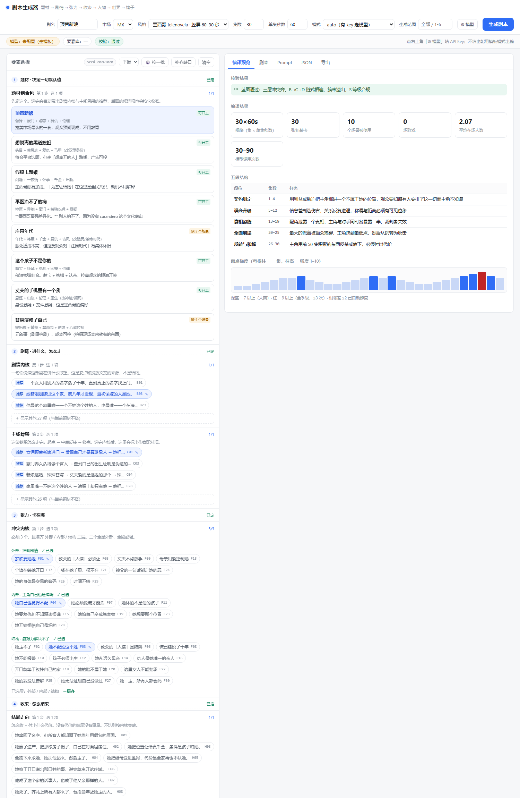
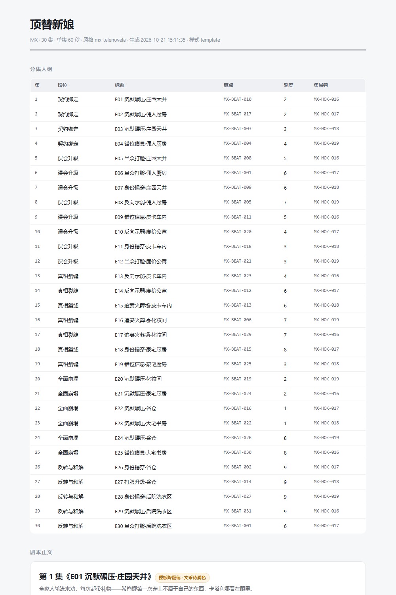
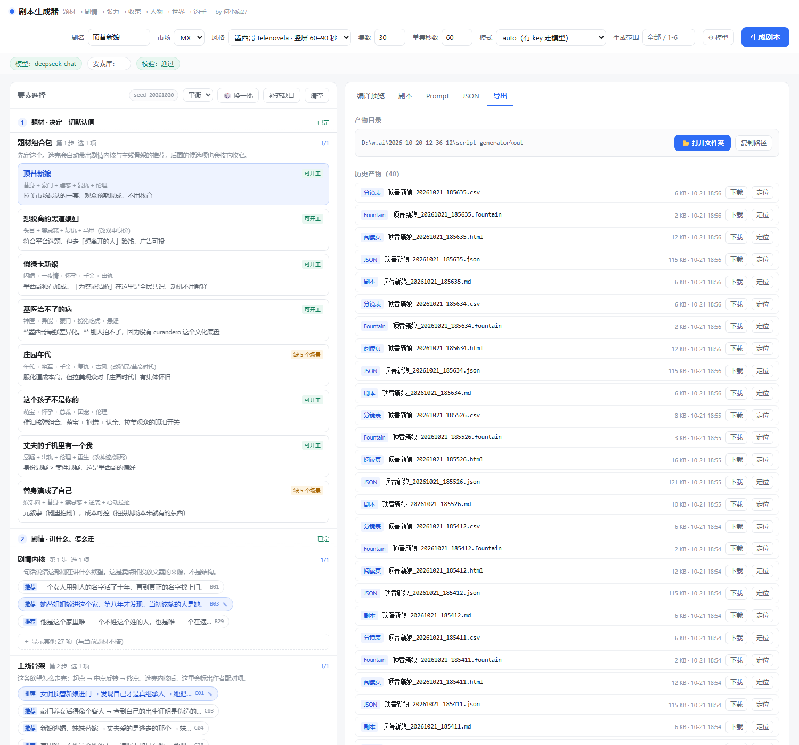

# 剧本生成器

把结构化要素拼装成短剧剧本。**结构由代码定，文字由模型写。**

> 作者：[何小疯27](https://github.com/Hejunlong27)

你选题材、内核、骨架、冲突、结局、人设、城市、开场钩 —— 编译器算出 30 集的分集结构，
模型只负责把每一集写成戏。输出结构统一、要素引用一致，没配 API Key 也能出稿。

## 它做什么

- **30 集 × 60 秒**（可改 1–200 集 / 15–180 秒），五段时间轴自动适配
- 要素按「题材 → 剧情 → 张力 → 收束 → 人物 → 世界 → 钩子」七步选，每步只显示相关项
- 爽点强度按四分位梯度排布，相邻不跳变、全季重锤不超 3 次
- 场景按布景成本自动复用（30 集用约 10 个景），人物出场按成本控制
- 生成后过三道校验：结构、要素引用、题材红线；不过就回喂重写
- 导出 Markdown / HTML / JSON / CSV / Fountain 五种

## 怎么用

### 方式一：直接下载（Windows，不需要装任何东西）

到 [Releases](https://github.com/Hejunlong27/script-generator/releases) 下载 `ScriptGenerator.exe`，
双击运行，浏览器自动打开界面。关掉窗口即退出。

出稿在 exe 同目录的 `out/` 里。界面「导出」页有一键**打开文件夹**，也能看到全部历史产物。

### 方式二：从源码运行

```bash
cd script-generator

# 1. 素材库 → 机器可读要素包（仓库里已带示例包，可跳过）
python tools/build_elements.py --market MX

# 2. 出稿（模板模式，不需要 API Key）
python cli.py gen -b examples/blueprint-bag1.json -m template -r 1-6 -o out

# 3. 起界面
python server.py          # http://127.0.0.1:8765
```

零第三方依赖，Python 3.10+。Windows 也可以直接双击根目录的 `启动.bat`，
它会自动选择源码模式或 exe 并打开浏览器。

**接模型**：界面右上角「⚙ 模型」，选 DeepSeek / OpenAI / 通义 / 智谱 / 本地 Ollama，
填 Key，点「测试连接」。Key 只存本机（源码模式在 `config.local.json`，exe 在 `%APPDATA%\ScriptGenerator`），不进版本库。

## 界面

选要素。左边七步走完就是一部剧，右边实时看校验和编译结果：



出稿。分集大纲 + 分场剧本 + 台词（西语原文 + 中文意译）：



导出。产物目录一键打开，历史文件都在这里，每个文件可单独下载或定位：



## 关于素材

完整素材库（412 条短剧素材）**不随源码公开**。

- 仓库里带的是 **100 条示例要素包**，够跑通全流程、够看懂它是怎么工作的
- 想用自己的素材：按 `material-library/` 的结构组织文件，跑 `python tools/build_elements.py --market MX`
- 打好的 exe **内置完整素材库**，下载即用，不需要自己准备

## 更新记录

**v1.0 — 2026-10-21**
- 首个发布版，Apache-2.0
- 提供 Windows 桌面版 exe（内置完整素材库）
- 源码仓库附带 100 条示例要素包
- 内核与主线按素材库标注的配对关系反查生成，消除错配
- 补齐加四道闸（等级过滤 / 配对抽取 / 题材簇上限 / 自查重试），300 组实测 0 告警
- 候选项按相关性折叠，冲突按外部/内部/结构分层显示
- 自动补齐改为带种子的加权随机，可复现、可换一批
- 规格 30 集 × 60 秒，时间轴与成本门槛随秒数联动
- 新增「题材」层（8 个组合包），要素顺序按认知顺序重排
- 模型配置进界面，Key 只存本机

## 作者与许可

作者：**何小疯27** · [github.com/Hejunlong27](https://github.com/Hejunlong27)

[Apache License 2.0](LICENSE) — 详见 [NOTICE](NOTICE)
